# KiMoRe Wrapper

> MATLAB and R wrangling toolkit for the KiMoRe kinematic rehabilitation dataset, converting raw Kinect motion capture into analysis-ready HDF5 structures with derived biomechanical features.

```mermaid
%%{init: {'theme': 'base', 'themeVariables': {'primaryColor': '#E8F4FD', 'primaryBorderColor': '#7BA7C9', 'primaryTextColor': '#2C3E50', 'secondaryColor': '#FDF2E9', 'secondaryBorderColor': '#D4A574', 'secondaryTextColor': '#2C3E50', 'tertiaryColor': '#EAFAF1', 'tertiaryBorderColor': '#82C9A1', 'tertiaryTextColor': '#2C3E50', 'lineColor': '#5D6D7E', 'textColor': '#2C3E50', 'background': '#FFFFFF', 'mainBkg': '#E8F4FD', 'nodeBorder': '#7BA7C9', 'clusterBkg': '#F8F9FA', 'clusterBorder': '#BDC3C7', 'fontSize': '14px'}}}%%
graph LR
    A[Raw Kinect Data] --> B[Joint Extraction]
    B --> C[Feature Computation]
    C --> D[Exercise Classification]
    D --> E[Clinical Scores]

    style A fill:#FDF2E9,stroke:#D4A574
    style B fill:#E8F4FD,stroke:#7BA7C9
    style C fill:#E8F4FD,stroke:#7BA7C9
    style D fill:#E8F4FD,stroke:#7BA7C9
    style E fill:#EAFAF1,stroke:#82C9A1
```



## Overview

The KiMoRe (KInematic assessment of MOvement and clinical scores for remote monitoring of physical REhabilitation) dataset provides Kinect v2 motion capture recordings of subjects performing five rehabilitation exercises. Subjects span healthy controls (expert and non-expert) and three patient groups: stroke, Parkinson's disease, and low back pain.

This repository provides the data wrangling layer between the raw KiMoRe dataset files and downstream analysis. The MATLAB scripts parse the original Kinect JSON skeletal data, validate joint trajectories, remove frames with low tracking confidence, and export the cleaned data as HDF5 and MAT files with a standardized hierarchical structure. An R script handles further statistical analysis and visualization.

The pipeline also computes derived biomechanical features per exercise (range of motion, angular velocities, trajectory smoothness) that can be used for exercise quality classification against the clinical scores provided in the original dataset.

## Key Features

- Batch conversion of raw Kinect skeletal JSON to structured HDF5/MAT formats
- Data quality validation with automatic detection of missing or corrupted joint trajectories
- Derived biomechanical feature extraction for all five KiMoRe exercises
- Hierarchical data organization: Subject > Exercise > Joint > Time Series
- R analysis scripts for statistical comparison across clinical groups
- Preserves original clinical metadata (age, gender, group labels, clinical scores)

## Quick Start

```bash
# Clone the repository
git clone https://github.com/petteriTeikari/KiMoRe_wrapper.git

# Place the KiMoRe dataset one level up
# Expected layout: ../Kimore/ relative to this repo

# In MATLAB, run the batch converter
matlab -r "run('matlab/matlab_to_R_batch_converter.m')"

# In R, run the wrangling and analysis
Rscript main_wrangling.R
```

## Data Structure

The exported HDF5 follows this hierarchy:

- **Joint Data**: `Subject > Exercise > Joint_Name` with 9 columns (time_ms, cameraX/Y/Z, confidenceState, AbsQuat 1-4)
- **Metadata**: gender (0=female, 1=male), age (years), group label

Group labels:

| Code   | Group                   | Label |
|--------|-------------------------|-------|
| CG-E   | Control, Expert         | 0     |
| CG-NE  | Control, Non-Expert     | 1     |
| GPP-S  | Stroke                  | 2     |
| GPP-P  | Parkinson's Disease     | 3     |
| GPP-B  | Low Back Pain           | 4     |

## Project Structure

```
KiMoRe_wrapper/
├── matlab/
│   ├── matlab_to_R_batch_converter.m   # Main batch conversion script
│   ├── compute_derived_features.m      # Biomechanical feature extraction
│   ├── combine_meta_with_joints.m      # Merge metadata with joint data
│   ├── re_arrange_data.m               # Data restructuring
│   ├── json_export_wrapper.m           # JSON parsing utilities
│   ├── hdf5export_wrapper.m            # HDF5 export
│   └── matlab_original/               # Original KiMoRe analysis scripts
│       ├── main_Ex[1-5].m             # Per-exercise main scripts
│       ├── preproc_Ex[1-5].m          # Per-exercise preprocessing
│       └── feat_extract_Ex[1-5].m     # Per-exercise feature extraction
├── main_wrangling.R                    # R analysis and visualization
└── imgs/                               # Documentation figures
```

## Citation

If you use this code or the KiMoRe dataset, please cite:

```bibtex
@article{capecci2019kimore,
  title={The KIMORE dataset: KInematic assessment of MOvement and clinical scores for remote monitoring of physical REhabilitation},
  author={Capecci, Marianna and Ceravolo, Maria Gabriella and Ferracuti, Francesco and Iarlori, Sabrina and Monteri{\`u}, Andrea and Romeo, Luca and Verdini, Federica},
  journal={IEEE Transactions on Neural Systems and Rehabilitation Engineering},
  volume={27},
  number={7},
  pages={1436--1448},
  year={2019},
  publisher={IEEE},
  doi={10.1109/TNSRE.2019.2923060}
}
```

## License

MIT
